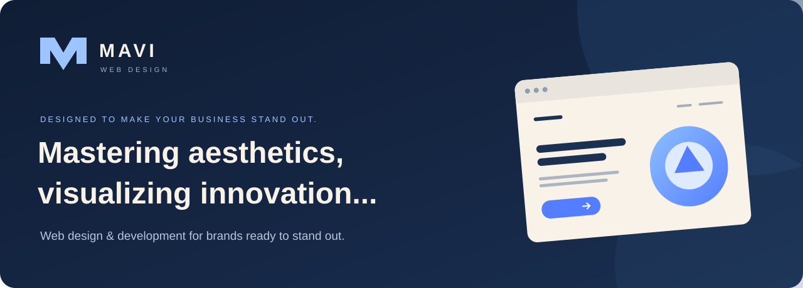

  

  <strong>Independent minds. One shared vision. A stronger online presence for your business.</strong>

  <a href="#about">About</a> &nbsp;·&nbsp;
  <a href="#services">Services</a> &nbsp;·&nbsp;
  <a href="#our-approach">Our approach</a> &nbsp;·&nbsp;
  <a href="#references">References</a> &nbsp;·&nbsp;
  <a href="#contact">Get in touch</a>

  

---

### A small team with a big eye for detail.

Hi, I'm **Christian** — the person behind this profile and part of **MAVI Web Design**.

We help startups, small businesses, and ambitious brands turn their ideas into a clear, confident online presence. Our team brings design and development together to create **modern, responsive websites** that look considered, feel intuitive, and make it easy for visitors to take the next step.

From a first launch to a fresh start, our focus is simple: **great design, fast experiences, and a strong foundation for search visibility.**

### What we can do for your business

<table>
<tr>
<td width="50%" valign="top">

#### 01 / Web design
A distinctive visual direction, clear page structure, and thoughtful details that help your business make a memorable first impression.

</td>
<td width="50%" valign="top">

#### 02 / Responsive development
Modern websites that adapt smoothly to phones, tablets, and desktops, with straightforward navigation and clear calls to action.

</td>
</tr>
<tr>
<td width="50%" valign="top">

#### 03 / Performance &amp; SEO
Attention to loading speed, semantic structure, metadata, and search-friendly content foundations so your website is easier to use and discover.

</td>
<td width="50%" valign="top">

#### 04 / Website refreshes
A fresh perspective on an existing site: clearer messaging, a more polished design, and a better journey from first visit to enquiry.

</td>
</tr>
</table>

### From “we need a website” to “this feels like us.”

**01 — Understand**  
We start with your business, your audience, and what your website needs to achieve.

**02 — Design**  
We shape the structure and visual direction around your brand, with room for your feedback.

**03 — Build & refine**  
We bring the design to life, with attention to mobile usability, performance, and SEO fundamentals.

**04 — Launch**  
We check the details together and prepare your website for its next chapter.

> **Our design philosophy:** Make it beautiful. Keep it clear. Give every page a purpose.

### Selected work & references

**Our portfolio is taking shape.** Project previews, live website links, and case studies will be added here as they become available.

<!--
PROJECT TEMPLATE — replace this comment with a real project when ready.
### [Client / Project name](https://real-project-url.example)
Brief: What did the client need?
Our work: What did MAVI design or build?
Outcome: Include a verified result, or describe the delivered improvement.
Add a screenshot with descriptive alt text.
-->

<strong>Client feedback — sample layout</strong>

 

**The quotes below are fictional placeholders for layout purposes. They are not real client testimonials.**

> “The website finally feels like our brand — clear, modern, and easy to use on mobile.”
>
> — **Sample client A** · Replace with an approved client quote

> “The team helped turn our ideas into a website that makes our business easier to understand.”
>
> — **Sample client B** · Replace with an approved client quote

<!-- Replace each sample with a real quote and the client's approved name / business before presenting it as a testimonial. -->

### Have a business worth showing off? Let's build its website.

Tell us a little about your business, what you want your website to do, and your ideal timeline. Whether you're starting from scratch or rethinking an existing site, we'd love to hear your plans.

  
  
  
  

**Email:** [christianczynski@gmail.com](mailto:christianczynski@gmail.com)  
**WhatsApp:** [+36 30 820 6614](https://wa.me/36308206614)  
**Connect:** [LinkedIn](https://www.linkedin.com/in/christian-czynski-263371262/) · [GitHub](https://github.com/CChrisso)

---

  <strong>MAVI WEB DESIGN</strong> 
  Thoughtful design. Purposeful websites.

